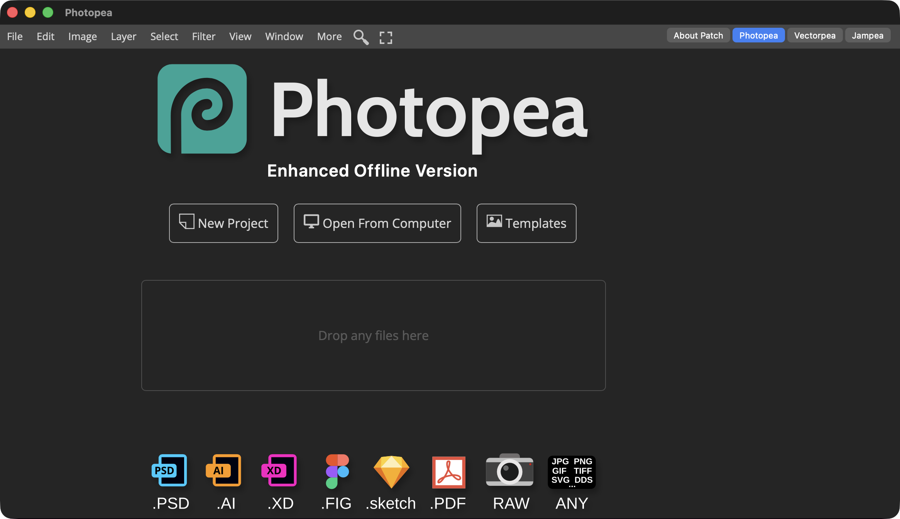
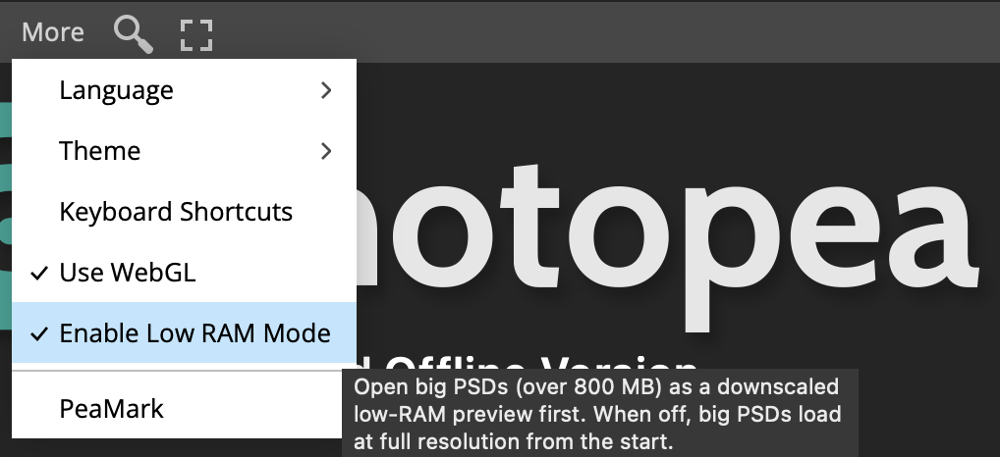

# Photopea Offline

A fully offline build of [Photopea](https://www.photopea.com) — **three tools in one app**,
no internet, no ads, no server. Switch between them from the toggle at the top-right:

- **Photopea** — photo/image editor (a free Photoshop alternative: PSD, layers, filters, RAW…)
- **Vectorpea** — vector editor (a free Illustrator alternative: AI, SVG, PDF)
- **Jampea** — music/MIDI editor with piano-roll and sheet views

All 50 interface languages are bundled.

## Download & run

Grab the latest [release](https://github.com/ptrinh/photopea-desktop/releases) and pick your platform:

| Platform | Download | How to run |
|---|---|---|
| **macOS** | `Photopea-macos.zip` | unzip, open `Photopea.app` (signed — opens on any Mac) |
| **Windows** | `Photopea-windows-app.zip` | run `Photopea-portable.exe` (one file, nothing to install) |
| **Linux** | `Photopea-linux-app.zip` | `chmod +x Photopea.AppImage` and run it |
| **Any device** | `photopea-offline.html` | just open the file in any modern browser |

> **Windows note:** the first time you run the `.exe`, Windows may show "Windows protected your
> PC" — click **More info → Run anyway**. This happens once (the app is safe, just not
> code-signed).

## Working with big PSD files

Big files can eat a lot of memory. Two things help:

1. **Use the desktop app** (Windows/Linux) rather than the plain HTML file in a browser tab — the
   app can use much more of your computer's RAM before running out.
2. **Low RAM Mode** — big PSDs open as a lightweight preview first (full layer list, but lower
   resolution) so they load fast and light. Pick an editing tool or click the badge to switch to
   full resolution. Toggle it under **More → Enable Low RAM Mode** (on by default; automatically
   off on machines with lots of RAM).

## Open your files with it

Double-click a file in your OS to open it in Photopea (PSD/PSB, AI, XD, Fig, Sketch, PDF, EPS,
SVG, images, RAW, and Jampea music formats — MIDI, Guitar Pro, MuseScore, MusicXML, SoundFont):

- **macOS** — `Photopea.app` registers automatically (run it once if Finder doesn't list it yet).
- **Windows** — run `Photopea-portable-OpenWith-Install.bat` (next to the exe). No admin needed;
  an uninstall script is included.
- **Linux** — run `Photopea-AppImage-openwith.sh` (next to the AppImage).

Files you open while the app is already running open in the same window.

## Good to know

- **Clipboard paste & custom fonts:** on the plain HTML file, use **Cmd/Ctrl+V** to paste and
  drag-and-drop `.ttf`/`.otf` files to add fonts. (The full clipboard and font panel only unlock
  when the app is served over `http://localhost` — see below.)
- **Jampea sound:** music playback and MIDI input work offline, including in the desktop apps.
- **Browser:** needs a modern browser — Chrome/Edge, Safari 16.4+, or Firefox 113+.

## Other ways to use it

- **Launchers** (`Photopea-windows.zip` / `Photopea-linux.zip`) — tiny `Photopea.bat` /
  `photopea.sh` scripts that open the HTML in an already-installed Chrome or Edge window.
- **Served** — host the HTML with any static server, e.g.
  `python3 -m http.server 8899 --bind 127.0.0.1`, then open
  http://localhost:8899/photopea-offline.html. This unlocks full clipboard paste and the local
  fonts panel.

---

Building from source, the command-line batch tool, and how the offline patch works are all in
[DEVELOPING.md](DEVELOPING.md).
